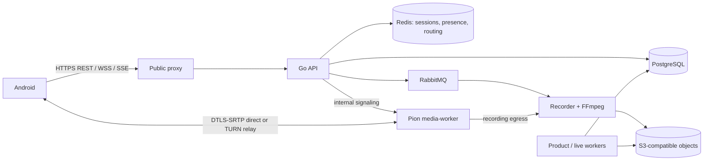
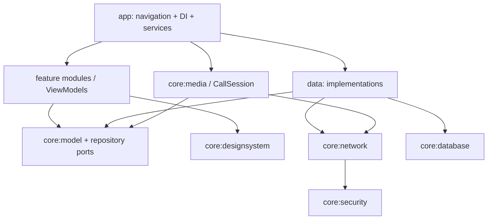

# MeetSpace Android — аудит и архитектура, этап 01

Дата: 11 октября 2026, Europe/Moscow. Статус: аудит завершён; внедрение Android не начиналось.

Бэкенд пригоден как основа нативного клиента: доменная модель, REST, личный и конференционный realtime, Pion SFU и серверная запись уже присутствуют. Готовность Android и совместимость с действующим сервером пока не доказаны. Главные ограничения: несовпадение идентификаторов сборки, потеря полей TURN в сигнализации, отсутствие автоматических тестов в проверенном дереве, неполный контракт мобильных push и демонстрационный установщик в дизайне.

Сопутствующие документы: [матрица API](API_MATRIX.md), [модель угроз установщика](INSTALLER_THREAT_MODEL.md), [план поставки](DELIVERY_PLAN.md).

## 1. Границы и доказательства

Запрос пользователя — аудит репозитория и архитектура Android. Приложенный `CODEX_ANDROID_01_01_AUDIT_ARCHITECTURE.md` использован как перечень результатов этапа. Рекомендация модели из вложения не является требованием изменить среду. Программный код, настройки работающего сервера и миграции не изменялись.

| Источник | Зафиксированное состояние |
|---|---|
| Репозиторий GitHub | `janickiy/meet-space`, `main`, **c861ec882633071da74c6825a3dbf2a19c1e32ed** |
| Изолированный checkout | `/Users/aleksandranickij/htdocs/Android/.audit/meet-space`; clone по HTTPS, tracked tree чистое |
| Существующий checkout | `/Users/aleksandranickij/htdocs/go-recorder`, тот же HEAD, есть staged-изменения frontend/design/docs; не изменялся |
| Проект `mobile_maket` | Его каталог пуст. Реальный вариант 01: `/Users/aleksandranickij/htdocs/go-recorder/design/meetspace-android-20261010`; использовано текущее локальное состояние, а не более старый дизайн из GitHub |
| Публичный сервер | `/version`: `v1.0.0-meeting.20261010-notifications.2`, commit **096c17b08352109f3f0b4d9f88d8e3825fd9e5fa**, buildTime `2026-10-10T12:24:32Z` |
| Проверка происхождения production | Запрос этого SHA через `git fetch --depth 1 origin <SHA>` отклонён: `not our ref`. Нельзя установить состав production по проверенному репозиторию или утверждать, что production просто «отстаёт» |
| Артефакты проверок | `.audit/evidence/`: логи Go/frontend, `public-probes.json`, `turn-tls.json`, хеши 14 исходных файлов локального дизайна |

Все GitHub-ссылки ниже закреплены за полным SHA. Ссылки на дизайн локальные, потому что его выбранная версия содержит незакоммиченные изменения. Старые отчёты, README и QA макета дают контекст, но не считаются результатами текущих испытаний.

Определения: **implemented** — маршрут/контракт и реализация найдены в коде; **partial** — основа есть, но сценарий имеет конкретный пробел; **absent** — реализация не обнаружена в данном дереве. Эти статусы не означают прохождение end-to-end на production.

## 2. Инвентаризация возможностей

| Область | Статус | Фактическая реализация и ограничение |
|---|---|---|
| Регистрация, вход, профиль, выход | implemented | [Маршруты][auth], [обработчик][auth-handler], JWT + серверная сессия. Профиль изменяет только `displayName` |
| Постоянная авторизация Android | partial | [Refresh через HttpOnly cookie][cookie], а не JSON refresh token; нужен отдельный защищённый CookieJar на origin/account |
| Гости и ограничения доступа | implemented | [Guest route][guest], [scope middleware][scope]. Гостю доступны только разрешённые операции своей встречи |
| Личные и групповые чаты | implemented | [Маршруты][personal], [типизированная Conversation][personal-model], [групповые роли/лимиты][groups]; права проверяет сервер |
| Сообщения, ответы, вложения, прочтение | implemented | [Общие маршруты][chat], [модель][chat-model]; отдельные namespaces `conferences` и `conversations` |
| Поиск, закрепление, материалы чата | partial | [Chat actions][chat-actions] зарегистрированы для конференционного чата. Не переносить эти URL механически в личный/групповой чат |
| Папки | implemented | [CRUD/порядок/элементы][folders]; только [conversation/conference][folder-model], не произвольные файлы или записи |
| Встречи, календарь, история, приглашения | implemented | [REST lifecycle][conferences], [timeline][timeline], [invitations][invitations]; календарь строится из scheduled conferences |
| Модерация, waiting room | implemented | [Media state/moderation][control], [состояния участника][conference-state]; join ещё не означает admission и готовность медиа |
| Входящие/пропущенные телефоноподобные звонки | absent | В [публичных маршрутах][conferences] есть конференции, нет сущности call с ring/accept/decline/missed. Вкладка «Звонки» пока должна отображать встречи/историю |
| Глобальный realtime пользователя | implemented | [Ticket-only WS][user-ws], receive-only stream, [проверка доступа перед доставкой][delivery] |
| Realtime встречи | implemented | [WS Bearer или ticket][ws-auth], [envelope v1][envelope], snapshot presence, media commands |
| Аудио/видео SFU | implemented | [Pion Opus/VP8][sfu-codecs], [лимиты][media-config], [web reference client][media-client] |
| Демонстрация экрана | implemented / Android partial | [Screen sources в SFU][sfu-screen] и [web-клиент][media-client] реализованы. Android MediaProjection и audio capture ещё не реализованы |
| TURN | partial | [Временные credentials][turn] и Coturn есть; [API теряет policy/expiry][media-joined]. TURNS TLS проверен, relay allocation и передача медиа не проверялись |
| Серверная запись | implemented | [Start/list/read/stop][records], [4 режима][record-model]; запись асинхронна, `202` не означает готовый файл |
| Единая библиотека всех записей | partial | API выдаёт записи по conference; [web UI сначала выбирает встречу][record-ui]. Глобального paginated endpoint записей не найдено |
| Уведомления в приложении | implemented | [REST + SSE][notifications], [обработчик SSE][sse] |
| Android push и фоновые входящие | partial | [Регистрация android device][device], [HTTP push gateway][push]; в дереве нет законченной FCM-интеграции/Android-клиента и call wake-up протокола |
| STT, summary, captions, поиск, аналитика | partial | [Content endpoints][content], [captions/analytics][captions]; включаются по [capabilities][capabilities] и конфигурации провайдеров. Действующая конфигурация неизвестна |
| Нативный Android | absent | Нет Gradle, AndroidManifest, Kotlin-приложения или APK в дереве; [handoff дизайна][design-handoff] явно ограничен HTML-прототипом |
| SSH-установка с Android | absent | [Дизайн onboarding][design-onboarding] имитирует проверку/установку. [Host bootstrap][bootstrap] привязан к конкретному серверу |
| Документированный машинный контракт | partial | DTO/handlers/frontend существуют; файлов OpenAPI/Swagger/AsyncAPI в checkout нет. Основа Android-контракта зафиксирована в `API_MATRIX.md` |

## 3. Бэкенд, данные и эксплуатация

Приложение — Go 1.26.9 + Gin, PostgreSQL, Redis, RabbitMQ, S3-compatible storage, Pion WebRTC. Web UI — React/TypeScript/Vite. Версии зафиксированы в [go.mod][go] и [package.json][frontend]. [Bootstrap API][wiring] действительно подключает изученные маршруты. Android использует публичный HTTPS origin; внутренние worker endpoints, Postgres, Redis, RabbitMQ и storage credentials ему не нужны.

Основание схемы: [API wiring][wiring], [media controller][media-controller], [production Compose][compose]. SFU пересылает RTP, бизнес-права остаются в API/БД; очереди записи не заменяют WS signaling.

### Compose и постоянные данные

| Компоненты | Код конфигурации | Данные/порты/замечания |
|---|---|---|
| api, media-worker, worker, product-worker, live-worker | [Production Compose][compose] | Раздельные процессы; внутренние HTTP 8085/8091/8090/8092/8093. SFU 50010 UDP/TCP; worker production отключает legacy ingest ports |
| postgres | [Production Compose][compose] | Named volume `postgres`, PostgreSQL 16 в dev-конфигурации; схема/членства/сессии/сообщения |
| redis | [Production Compose][compose] | В production без AOF/snapshots; presence, locks, routing не заменяют постоянную БД |
| rabbitmq | [Production Compose][compose] | Named volume `rabbitmq`; наружная management UI для Android не нужна |
| minio / hardened object storage | [Classic][compose], [hardened override][hardened] | Classic volume `minio`; hardened — `objects`; нельзя восстанавливать backup в неверный layout |
| recorder scratch | [Production Compose][compose] | Bind `RECORDER_STORAGE_DIR:/storage`, UID/GID 1000; нужен контроль свободного места и незавершённых записей |
| proxy/frontend/TLS | [Routes][routes], [shared-host override][shared] | Classic 443; shared-host 127.0.0.1:19080 за внешним Apache. `/health`, `/metrics`, `/internal` скрыты снаружи |
| coturn | [Compose][compose], [turnserver.conf][turn-config] | 3478 UDP/TCP, 5349 TCP/TLS, relay UDP 49160–49259 по defaults; host-specific bootstrap сокращает диапазон до 49199; shared-host использует host networking |
| observability | [Compose][compose] | Prometheus profile, named volume, localhost 19090; это не API мобильного клиента |

Dev [docker-compose.yml][compose-dev] публикует сервисные порты и содержит development-настройки; его нельзя считать безопасным production manifest. Production использует `*_IMAGE` из release manifest, а не гарантированный набор тегов: [release validation][release]. Фактические image digests, volumes, free disk и процессы production в этом аудите не инспектировались по SSH.

Найдены **33 up-миграции и 10 down-миграций**, последняя — `000033_direct_conversation_preferences`. Основные группы: 000006–000009 users/conferences/participants/sessions; 000010 запись; 000013–000016 chat/notifications/jobs/integrations; 000023 guests; 000026 durable auth; 000028 direct chats; 000029 conference chat actions; 000030 groups; 000031 avatars; 000032 folders; 000033 direct preferences. Применение выполняет [migrator][migrations]. Отсутствие части down-миграций исключает предположение об универсальном автоматическом schema rollback.

Есть scripts/release для build/package/validate/deploy, backup/restore и certificate renew: [release common][release], [release commands][deploy], [backup][backup], [restore check][restore], [renew][renew]. Они дают базу эксплуатации, но не готовый универсальный Android installer. Старый [ci-deploy.sh][legacy-deploy] использует `StrictHostKeyChecking=accept-new`: это TOFU при первом контакте, а не предварительно проверенный fingerprint.

### Публичная проверка 11.10.2026

| Проверка без авторизации | Результат |
|---|---|
| DNS системного resolver | `meeting.janickiy.com → 93.89.223.151`; других адресов resolver не вернул. Это не полный DNS-аудит зоны |
| `GET /` | 200, HTML |
| `GET /version` | 200, JSON с версией и SHA, указанными выше |
| `GET /health`, `/health/live`, `/health/ready` | 404, согласуется с [proxy rules][routes]; не свидетельствует о нездоровом API |
| `GET /api/v1/auth/me`, `/capabilities`, `/webrtc/config` | Все 401, JSON; защищённые данные не выдаются без входа |
| HTTPS TLS на 443 | Цепочка/имя проверены системным trust store, TLS 1.3, Let's Encrypt YR1 |
| Сертификат | SAN `meeting.janickiy.com`; 03.10.2026 14:01:16 UTC — 01.01.2027 14:01:15 UTC |
| TLS на 5349 | Успешный handshake с проверкой hostname/цепочки, TLS 1.3, тот же срок сертификата. Это не TURN Allocate и не media relay test |

Проверки не создавали аккаунты, встречи и записи. Не выполнялись SSH-вход, изменение окружения, deployment, нагрузка или authenticated smoke. Содержимое ответов сохранено локально без credentials. Сведения `/version` — заявленные сервером метаданные, не независимая аттестация бинарников.

### Минимальные требования: что известно

Подтверждены необходимые компоненты, а не аппаратный минимум. Существующий [capacity report][baseline] описывает старую локальную среду и отсутствующие сейчас test targets; использовать его как SLA нельзя. Числа «4 ядра / 8 ГБ / 80 ГБ» в [макете][design-onboarding] демонстрационные.

Предложение для первого отдельного тестового VPS: Linux с systemd и Docker Engine/Compose, 4 vCPU, 8 GiB RAM, 80 GiB SSD, публичный IP, DNS и доверенный TLS. Это **плановая отправная точка**, не доказанный минимум и не рекомендация покупать сервер без измерений. Для production нужны measured peak RAM/CPU, число участников/комнат/записей, retention и uplink. Установщик обязан обнаруживать нехватку, а не обещать поддержку по названию тарифа.

Оценка места на запись: `суммарный битрейт, бит/с × длительность, с / 8`; дополнительно scratch, финальные артефакты, backups и резерв. При 2 Мбит/с один час — около 0.9 GB до накладных расходов. У SFU исходящий трафик растёт с числом подписчиков; индивидуальные треки и несколько комнат меняют расчёт. В [host bootstrap][bootstrap] заданы 2 комнаты × 4 peer, одна запись до часа/512 MiB — это лимиты шаблона, не измеренная ёмкость действующего VPS.

Для Android предложен minSdk 26, arm64-v8a на реальных устройствах и x86_64 для emulator. Это проектное решение, подлежащее проверке выбранным WebRTC AAR и парком устройств. Compile/target SDK, AGP, Kotlin и Compose нужно закрепить совместимым набором на этапе 02; аудит не объявляет непроверенные версии «последними». Приоритет: планшеты 7–13", portrait/landscape/multiwindow; телефоны используют тот же adaptive UI.

## 4. Найденные риски и пробелы

| ID / приоритет | Доказательство | Последствие / необходимое действие |
|---|---|---|
| R01 / высокий | `/version` production ≠ GitHub SHA; remote не отдаёт SHA production | До клиентского release получить manifest/source этой сборки или выделить согласованный staging; проверить контракты там |
| R02 / высокий | [Worker][media-ice] возвращает `ICETransportPolicy`/`ICEExpiresAt`, [controller][media-joined] их не включает в WS `media.joined`; [web client][media-policy] по отсутствующему policy выбирает `all` | При `TURN_FORCE_RELAY=true` клиент может использовать direct path; expiry также теряется. Backend fix + regression и forced-relay test нужны до media release. Для временного Android adapter читать `/webrtc/config`, согласовать источник credentials и policy; не считать это исправлением сервера |
| R03 / высокий | `go test`: 82 `[no test files]`; CI содержит vet/build, [frontend scripts][frontend] без test runner | Нельзя опираться на старые утверждения о hundreds tests. Восстановить контрактные/интеграционные проверки и Android device tests |
| R04 / высокий | [Native WebRTC API][media-model] сложнее стандартного offer/answer; [media.ready][media-ready] обязателен | Сперва проверить interoperable звонок на двух Android/Android+web, поздний join, screen, reconnect, callbacks/threads; SDK/codec не выбирать только по наличию Maven artifact |
| R05 / средний | [Refresh][cookie] принимает cookie; [сессия][refresh] переиспользует secret, cookie выдаётся на 400 дней | Раздельное зашифрованное хранение, revoke/logout, backup exclusions; server-side lifetime/rotation — отдельное улучшение. Не сохранять пароль для auto-login |
| R06 / высокий для background calling | [Push gateway][push], [device register][device]; законченный ringing-протокол отсутствует | MVP: уведомления в открытом приложении. Фоновый push выпускается после реальной доставки, permission/Doze/отзыва device token; WS не гарантирует работу в фоне |
| R07 / высокий для installer | [Прототип][design-onboarding], [host-specific scripts][bootstrap] | Установщик выделить в отдельный этап с контрактом preflight/job/resume и моделью угроз |
| R08 / средний | [Capabilities][capabilities] описывает AI/recording, но не versions/groups/folders/push/installer | Нужна фиксированная compatibility baseline и будущий capability contract; неизвестный feature выключать с объяснением, не подменять успехом |
| R09 / средний | [Folder kinds][folder-model], [recording selection][record-ui], [profile request][profile] | Дизайн богаче API: нет папок записей, редактирования email/пароля/статуса presence и общей страницы записей на сервере |
| R10 / средний | [Старый media документ][old-sfu-doc] говорит об отсутствии TURN, но [код][turn] его реализует; старые test/load targets отсутствуют | Источник истины — закреплённый код/контракт + текущие измерения; документацию backend актуализировать отдельной задачей |

Локально также обнаружено хранение credential внутри URL Git remote существующего checkout. Значение не включено в документы и не переносилось в новую копию. Рекомендуется отозвать/заменить этот credential и хранить доступ через credential manager; это гигиена рабочего окружения, не доказательство компрометации production.

## 5. Предлагаемая архитектура Android

Следующие модули и контракты — **проект**, их файлов ещё нет. Kotlin, Jetpack Compose, Material 3, Coroutines/Flow, ViewModel и однонаправленный поток состояния. REST — Retrofit/OkHttp с Kotlin serialization; WS/SSE — отдельные адаптеры OkHttp. Room для ограниченного кэша, DataStore для несекретных настроек, DI в composition root (предложение: Hilt). Media3 для записей. Конкретные версии фиксируются после media spike.

| Модуль | Ответственность и граница |
|---|---|
| `:app` | Activity, navigation, DI, deep links, Android services, сборка приложения |
| `:core:model` | Domain IDs, статусы, ошибки, immutable models и repository interfaces; без HTTP/Android UI |
| `:core:network` | REST DTO/serializers, отдельные conference WS/user WS/SSE, timeouts и безопасные redirects |
| `:core:security` | Origin/account-scoped session store, Keystore-backed encryption, cookie policy, redaction |
| `:core:database` | Room cache/outbox, account scope, migration и purge; без хранения паролей, SDP, ICE credentials |
| `:core:designsystem` | Токены варианта 01, typography, адаптивные контейнеры, reusable loading/error/empty states |
| `:core:media` | Обёртка libwebrtc, PeerConnection/track/capture/audio route, serial negotiation; UI не владеет медиаресурсами |
| `:data` | Repository implementations, DTO mapping, reconciliation REST/events, retry и локальные pending операции |
| `:feature:session` | Подключение к серверу, вход, гостевой путь, несовместимый сервер |
| `:feature:meetings` | Главная/Звонки, календарь, prejoin, waiting room, экран встречи |
| `:feature:chat` | Личные/групповые беседы, конференционный чат, attachments и read state |
| `:feature:library` | Папки, записи по встрече, просмотр/скачивание |
| `:feature:profile` | Имя, настройки приложения, уведомления, смена пространства и logout |
| `:feature:installer` (позже) | Отдельный опциональный административный сценарий; без зависимости обычных feature-модулей от SSH |

На этапе 02 создавать только модули, нужные для server/login vertical slice. Не создавать пустые feature-модули ради дерева каталогов.

Repository интерфейсы не повторяют серверную бизнес-логику: `SessionRepository` управляет входом/refresh/logout, `ConferenceRepository` — lifecycle и snapshots, `ConversationRepository` — типом/членством и списком, `MessageRepository` — paginated messages и delivery state, `RecordingRepository` — асинхронным состоянием записи, `FolderRepository` — владельческими папками. Сервер решает права, admission, роли и окончательные статусы. Клиентская валидация улучшает UX, но не выдаёт разрешений.

### Состояния и жизненный цикл

- `ServerProfile = normalized HTTPS origin + profileId`; данные и сессии разделяются ещё и по accountId. Смена origin закрывает WS/SSE/call, отменяет запросы, меняет cache namespace. Никакого переноса Bearer/cookie/SSH trust между серверами.
- Авторизация: `NoServer → Probing → SignedOut → Authenticating → Authorized`; возможны `Unreachable`, `UntrustedTls`, `Incompatible`, `SessionExpired`. `401` запускает один shared refresh; повтор — максимум один. `403` не запускает refresh. Изменяющие запросы повторять автоматически только при доказанной безопасности/idempotency.
- Звонок: `Idle → PreJoin → Joining → WaitingAdmission → ConnectingSignaling → Negotiating → Connected → Reconnecting → Leaving → Ended/Failed`. Некоторые шаги пропускаются при уже выданном admission. UI показывает отдельно WS, media и состояние серверной записи.
- `CallSession` живёт в отдельном service/application scope, не в composable и не в навигационном back stack. ViewModel подписывается на StateFlow; renderers присоединяются/освобождаются при смене surface. Поворот не создаёт второй peer, не выполняет новый REST join и не включает камеру заново.
- Process death не восстанавливает живой PeerConnection. После запуска получить серверное состояние и предложить повторное подключение; камеру/микрофон включать с корректным согласием/permissions. Foreground service не гарантирует бессмертие процесса.
- REST snapshot — источник восстановления после разрыва. WS/SSE — события и invalidation, не долговечный журнал. Дедупликация по event/message ID, применение версий/sequence, refetch при gap. После удаления из группы purge недоступных данных и закрытие её экрана.
- Сообщение хранит `clientRequestId` UUID на весь цикл retry; локальные `pending/failed` не являются серверным success. Вложения показывают init/upload/finalize отдельно. WorkManager — отложенная синхронизация, не постоянный канал звонка.

### Авторизация и конфиденциальность

Access token держать в памяти; cookie сессии хранить зашифрованно с ключом Android Keystore, отдельно для точного origin/account. Соблюдать Path `/api/v1/auth`, Secure и expiry; не применять браузерный глобальный CookieManager. KeyStore защищает ключ, а зашифрованные значения лежат в приватном хранилище приложения ([официальная документация](https://developer.android.com/privacy-and-security/keystore)). Исключить auth/cache с приватными данными из cloud backup. При logout закрыть каналы и удалить локальную сессию; если сервер недоступен, явно сообщить, что remote revoke не подтверждён.

Запретить cleartext и небезопасные TrustManager/HostnameVerifier. Self-hosted сертификат проверять обычной доверенной цепочкой; дополнительный управляемый CA возможен отдельной политикой. Presigned storage URL обрабатывать отдельным клиентом без Bearer/cookie, не логировать query. Токены, пароли, сообщения, SDP/ICE, TURN credentials и private keys исключить из telemetry; оставлять correlation ID, безопасный error code и обезличенные метрики.

### Планшеты и дизайн варианта 01

Основа — [текущий локальный screens.js][design] и [handoff][design-handoff]. Четыре корневые вкладки: **Главная, Звонки, Чаты, Профиль**; календарь и записи доступны внутри сценариев звонков. «Все» в чатах включает direct и group; «Личные» фильтрует `type=direct`; группа показывает `memberCount`, роль и `lastSender`. Демонстрационные данные и кнопки успеха в приложение не переносить.

WindowSizeClass вычислять по текущему окну: compact <600dp — одна панель; medium 600–839dp — rail и подходящая по высоте компоновка; expanded ≥840dp — список/детали чата или список/контент. Для ≥1200dp учитывать large, ≥1600dp extra-large; ограничивать ширину чтения. Compact height в landscape может требовать одну панель даже при большой ширине. Это соответствует [Android adaptive guidance](https://developer.android.com/develop/ui/compose/layouts/adaptive/use-window-size-classes).

Сохранять выделенную беседу, scroll, draft и фильтры при resize; IME/insets, TalkBack, font scale до 200%, контраст и touch targets ≥48dp проверять отдельно. Светлая/тёмная темы берут токены из текущих `app.css` + `telemost.css`; пиксели HTML не являются dp-спецификацией. В запросе нет создания нового дизайна.

### Android WebRTC: решения, требующие доказательства

1. Выбрать поддерживаемую libwebrtc AAR по upstream revision, лицензиям, доступным ABI и воспроизводимости. Не использовать старый Maven artifact только потому, что его имя встречается в примере. При самостоятельной upstream-сборке нужен Linux build environment ([WebRTC Android guide](https://webrtc.googlesource.com/src/+/refs/heads/main/docs/native-code/android/)).
2. Unified Plan, max-bundle, Opus + VP8; [сервер не регистрирует H.264][sfu-codecs]. Проверить hardware/software VP8, CPU/нагрев и 16 KiB page-size совместимость всех native `.so` на целевых устройствах. Факт регистрации кодеков не доказывает поддержку конкретного планшета.
3. Следовать web-контракту четырёх source slots и дополнительных recv slots: [reference client][media-client] создаёт `4 × maxPeers` трансиверов всего (при 10 — 40). Проверить размер SDP ≤48 KiB, предельные устройства и число одновременно декодируемых видео.
4. Один serial actor для offer/answer/ready и source replacement; pending ICE до remote SDP; новый negotiationId для нового offer; поздние callbacks от старого peer игнорировать. Track mapping по server metadata/streamId/kind/source, а не предполагать совпадение Android track.id с server track UUID.
5. Native permissions CAMERA/RECORD_AUDIO и корректные foreground service types camera/microphone; запуск по действию видимого пользователя, обработка запрета. Screen capture — отдельное согласие MediaProjection, тип mediaProjection и cleanup при stop. См. [FGS](https://developer.android.com/develop/background-work/services/fgs/service-types) и [MediaProjection](https://developer.android.com/media/grow/media-projection). Захват системного аудио не обещать для всех приложений/устройств.
6. Wi-Fi↔LTE, relay-only, UDP blocked, Bluetooth/wired/speaker, audio focus, interruptions, многозадачность и background — отдельные device tests. При потере peer сначала освободить старый ресурс и заново подтвердить admission/session; не бесконечно повторять ICE с просроченными credentials.

## 6. Что проверено сейчас

| Проверка | Фактический результат |
|---|---|
| GitHub HEAD / чистый audit checkout | SHA подтверждён, tracked files не изменены |
| `go test ./...`, Go 1.26.9 | Exit 0, 82 пакета, **0 test files**. Это компиляционная проверка, не поведенческое покрытие |
| `go vet ./...` | Exit 0, диагностик нет |
| `npm ci --ignore-scripts --no-audit --no-fund` | Exit 0, 35 packages. Системный Node 23.1.0 дал EBADENGINE; не скрыто |
| `npm run check` | Lint, TypeScript и Vite build прошли; затем повторены на поддерживаемом Node **24.19.0**, exit 0. Dependency audit не запускался |
| `docker compose --env-file .env.example config --no-env-resolution --quiet` | Exit 0: синтаксис dev Compose без чтения production env. Контейнеры не поднимались |
| `bash -n` scripts и docker shell files | 19 файлов, ошибок нет; скрипты не исполнялись |
| Public HTTPS/TLS/TURNS TLS | Результаты в разделе 3; authenticated API/media не проверены |
| Сопоставление source/дизайна/ссылок отчёта | Проверены локальные файлы и закреплённые source anchors |
| Android APK, emulator/device, WebRTC e2e, TURN Allocate, запись, migrations/backup restore | **Не запускались**: Android проекта ещё нет; тестовые аккаунты, staging и production manifest не предоставлены |

Артефакты frontend build и npm install находятся только в `.audit/meet-space/frontend`, игнорируются исходным Git. Race detector без тестов не запускался. Старые QA reports макета не выдаются за новые Android-проверки.

## 7. Unknowns и следующий шаг

Нужно установить: источник production SHA/manifest; реальные capability/provider flags и миграции; тестовые учётные записи с разными ролями; разрешённый staging; фактический TURN relay; supported device/API/ABI list; требования к фоновым вызовам и push-провайдеру; retention/cache/download policy; scope гостевого доступа; источники подписанного installer release и поддерживаемые ОС/VPS layouts.

Следующий этап — отдельное поручение по `DELIVERY_PLAN.md`: server/auth vertical slice, фиксация контрактов и затем WebRTC spike. Изменений backend/Android на этом этапе нет. Аудит не разрешает автоматически переходить к реализации, миграциям или deployment.

[auth]: https://github.com/janickiy/meet-space/blob/c861ec882633071da74c6825a3dbf2a19c1e32ed/internal/transport/http/platform_routes.go#L19
[auth-handler]: https://github.com/janickiy/meet-space/blob/c861ec882633071da74c6825a3dbf2a19c1e32ed/internal/app/auth/handler.go#L98
[backup]: https://github.com/janickiy/meet-space/blob/c861ec882633071da74c6825a3dbf2a19c1e32ed/scripts/release/backup.sh#L1
[baseline]: https://github.com/janickiy/meet-space/blob/c861ec882633071da74c6825a3dbf2a19c1e32ed/docs/CAPACITY_BASELINE.md#L24
[bootstrap]: https://github.com/janickiy/meet-space/blob/c861ec882633071da74c6825a3dbf2a19c1e32ed/scripts/release/init-meeting-host.sh#L5
[capabilities]: https://github.com/janickiy/meet-space/blob/c861ec882633071da74c6825a3dbf2a19c1e32ed/internal/domain/platform/platform.go#L7
[captions]: https://github.com/janickiy/meet-space/blob/c861ec882633071da74c6825a3dbf2a19c1e32ed/internal/transport/http/captions_routes.go#L12
[chat]: https://github.com/janickiy/meet-space/blob/c861ec882633071da74c6825a3dbf2a19c1e32ed/internal/transport/http/chat_routes.go#L23
[chat-actions]: https://github.com/janickiy/meet-space/blob/c861ec882633071da74c6825a3dbf2a19c1e32ed/internal/transport/http/chat_actions_routes.go#L12
[chat-model]: https://github.com/janickiy/meet-space/blob/c861ec882633071da74c6825a3dbf2a19c1e32ed/internal/domain/chat/chat.go#L20
[compose]: https://github.com/janickiy/meet-space/blob/c861ec882633071da74c6825a3dbf2a19c1e32ed/docker-compose.production.yml#L11
[compose-dev]: https://github.com/janickiy/meet-space/blob/c861ec882633071da74c6825a3dbf2a19c1e32ed/docker-compose.yml#L10
[conference-state]: https://github.com/janickiy/meet-space/blob/c861ec882633071da74c6825a3dbf2a19c1e32ed/internal/domain/conferences/conference.go#L18
[conferences]: https://github.com/janickiy/meet-space/blob/c861ec882633071da74c6825a3dbf2a19c1e32ed/internal/transport/http/platform_routes.go#L33
[content]: https://github.com/janickiy/meet-space/blob/c861ec882633071da74c6825a3dbf2a19c1e32ed/internal/transport/http/content_routes.go#L12
[control]: https://github.com/janickiy/meet-space/blob/c861ec882633071da74c6825a3dbf2a19c1e32ed/internal/transport/http/platform_routes.go#L63
[cookie]: https://github.com/janickiy/meet-space/blob/c861ec882633071da74c6825a3dbf2a19c1e32ed/internal/app/auth/sessions.go#L18
[delivery]: https://github.com/janickiy/meet-space/blob/c861ec882633071da74c6825a3dbf2a19c1e32ed/internal/transport/websocket/user_delivery.go#L49
[deploy]: https://github.com/janickiy/meet-space/blob/c861ec882633071da74c6825a3dbf2a19c1e32ed/scripts/release/release.sh#L12
[design]: /Users/aleksandranickij/htdocs/go-recorder/design/meetspace-android-20261010/screens.js:9
[design-handoff]: /Users/aleksandranickij/htdocs/go-recorder/design/meetspace-android-20261010/handoff.html:36
[design-onboarding]: /Users/aleksandranickij/htdocs/go-recorder/design/meetspace-android-20261010/onboarding.js:19
[device]: https://github.com/janickiy/meet-space/blob/c861ec882633071da74c6825a3dbf2a19c1e32ed/internal/usecase/integrations/service.go#L226
[envelope]: https://github.com/janickiy/meet-space/blob/c861ec882633071da74c6825a3dbf2a19c1e32ed/internal/domain/realtime/realtime.go#L39
[folder-model]: https://github.com/janickiy/meet-space/blob/c861ec882633071da74c6825a3dbf2a19c1e32ed/internal/domain/folders/folders.go#L66
[folders]: https://github.com/janickiy/meet-space/blob/c861ec882633071da74c6825a3dbf2a19c1e32ed/internal/transport/http/folder_routes.go#L10
[frontend]: https://github.com/janickiy/meet-space/blob/c861ec882633071da74c6825a3dbf2a19c1e32ed/frontend/package.json#L9
[go]: https://github.com/janickiy/meet-space/blob/c861ec882633071da74c6825a3dbf2a19c1e32ed/go.mod#L3
[groups]: https://github.com/janickiy/meet-space/blob/c861ec882633071da74c6825a3dbf2a19c1e32ed/internal/domain/personal/groups.go#L32
[guest]: https://github.com/janickiy/meet-space/blob/c861ec882633071da74c6825a3dbf2a19c1e32ed/internal/transport/http/guest_routes.go#L10
[hardened]: https://github.com/janickiy/meet-space/blob/c861ec882633071da74c6825a3dbf2a19c1e32ed/docker-compose.hardened.yml#L3
[invitations]: https://github.com/janickiy/meet-space/blob/c861ec882633071da74c6825a3dbf2a19c1e32ed/internal/transport/http/invitation_routes.go#L11
[legacy-deploy]: https://github.com/janickiy/meet-space/blob/c861ec882633071da74c6825a3dbf2a19c1e32ed/scripts/ci-deploy.sh#L28
[media-client]: https://github.com/janickiy/meet-space/blob/c861ec882633071da74c6825a3dbf2a19c1e32ed/frontend/src/media.ts#L1570
[media-config]: https://github.com/janickiy/meet-space/blob/c861ec882633071da74c6825a3dbf2a19c1e32ed/internal/config/media.go#L31
[media-controller]: https://github.com/janickiy/meet-space/blob/c861ec882633071da74c6825a3dbf2a19c1e32ed/internal/usecase/media/controller.go#L278
[media-ice]: https://github.com/janickiy/meet-space/blob/c861ec882633071da74c6825a3dbf2a19c1e32ed/internal/transport/mediaworker/handler.go#L689
[media-joined]: https://github.com/janickiy/meet-space/blob/c861ec882633071da74c6825a3dbf2a19c1e32ed/internal/usecase/media/controller.go#L402
[media-model]: https://github.com/janickiy/meet-space/blob/c861ec882633071da74c6825a3dbf2a19c1e32ed/internal/domain/media/media.go#L230
[media-policy]: https://github.com/janickiy/meet-space/blob/c861ec882633071da74c6825a3dbf2a19c1e32ed/frontend/src/media.ts#L1400
[media-ready]: https://github.com/janickiy/meet-space/blob/c861ec882633071da74c6825a3dbf2a19c1e32ed/frontend/src/media.ts#L1428
[migrations]: https://github.com/janickiy/meet-space/blob/c861ec882633071da74c6825a3dbf2a19c1e32ed/internal/infrastructure/postgres/migrations.go#L1
[notifications]: https://github.com/janickiy/meet-space/blob/c861ec882633071da74c6825a3dbf2a19c1e32ed/internal/transport/http/notification_routes.go#L14
[old-sfu-doc]: https://github.com/janickiy/meet-space/blob/c861ec882633071da74c6825a3dbf2a19c1e32ed/docs/media-sfu.md#L138
[personal]: https://github.com/janickiy/meet-space/blob/c861ec882633071da74c6825a3dbf2a19c1e32ed/internal/transport/http/personal_routes.go#L11
[personal-model]: https://github.com/janickiy/meet-space/blob/c861ec882633071da74c6825a3dbf2a19c1e32ed/internal/domain/personal/personal.go#L10
[profile]: https://github.com/janickiy/meet-space/blob/c861ec882633071da74c6825a3dbf2a19c1e32ed/internal/domain/users/user.go#L95
[push]: https://github.com/janickiy/meet-space/blob/c861ec882633071da74c6825a3dbf2a19c1e32ed/internal/infrastructure/providers/integrations.go#L181
[record-model]: https://github.com/janickiy/meet-space/blob/c861ec882633071da74c6825a3dbf2a19c1e32ed/internal/domain/records/conference.go#L15
[record-ui]: https://github.com/janickiy/meet-space/blob/c861ec882633071da74c6825a3dbf2a19c1e32ed/frontend/src/pages/RecordingsPage.tsx#L218
[records]: https://github.com/janickiy/meet-space/blob/c861ec882633071da74c6825a3dbf2a19c1e32ed/internal/transport/http/conference_recording_routes.go#L14
[refresh]: https://github.com/janickiy/meet-space/blob/c861ec882633071da74c6825a3dbf2a19c1e32ed/internal/usecase/auth/sessions.go#L118
[release]: https://github.com/janickiy/meet-space/blob/c861ec882633071da74c6825a3dbf2a19c1e32ed/scripts/release/common.sh#L63
[renew]: https://github.com/janickiy/meet-space/blob/c861ec882633071da74c6825a3dbf2a19c1e32ed/scripts/release/renew-meeting-certificate.sh#L5
[restore]: https://github.com/janickiy/meet-space/blob/c861ec882633071da74c6825a3dbf2a19c1e32ed/scripts/release/restore-check.sh#L1
[routes]: https://github.com/janickiy/meet-space/blob/c861ec882633071da74c6825a3dbf2a19c1e32ed/dockers/production/routes.conf#L2
[scope]: https://github.com/janickiy/meet-space/blob/c861ec882633071da74c6825a3dbf2a19c1e32ed/internal/transport/http/middleware/auth.go#L26
[sfu-codecs]: https://github.com/janickiy/meet-space/blob/c861ec882633071da74c6825a3dbf2a19c1e32ed/internal/infrastructure/sfu/manager.go#L223
[sfu-screen]: https://github.com/janickiy/meet-space/blob/c861ec882633071da74c6825a3dbf2a19c1e32ed/internal/infrastructure/sfu/tracks.go#L211
[shared]: https://github.com/janickiy/meet-space/blob/c861ec882633071da74c6825a3dbf2a19c1e32ed/docker-compose.shared-host.yml#L2
[sse]: https://github.com/janickiy/meet-space/blob/c861ec882633071da74c6825a3dbf2a19c1e32ed/internal/app/notifications/handler.go#L171
[timeline]: https://github.com/janickiy/meet-space/blob/c861ec882633071da74c6825a3dbf2a19c1e32ed/internal/app/conferences/product_handler.go#L101
[turn]: https://github.com/janickiy/meet-space/blob/c861ec882633071da74c6825a3dbf2a19c1e32ed/internal/config/turn.go#L66
[turn-config]: https://github.com/janickiy/meet-space/blob/c861ec882633071da74c6825a3dbf2a19c1e32ed/dockers/turn/turnserver.conf#L2
[user-ws]: https://github.com/janickiy/meet-space/blob/c861ec882633071da74c6825a3dbf2a19c1e32ed/internal/transport/websocket/user_handler.go#L118
[wiring]: https://github.com/janickiy/meet-space/blob/c861ec882633071da74c6825a3dbf2a19c1e32ed/internal/app/api.go#L162
[ws-auth]: https://github.com/janickiy/meet-space/blob/c861ec882633071da74c6825a3dbf2a19c1e32ed/internal/transport/websocket/handler.go#L325
