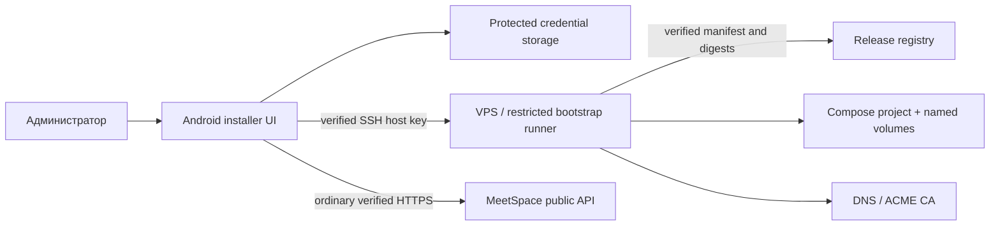

# MeetSpace Android — модель угроз SSH-установщика

11.10.2026. Статус: проект требований, **установщик не реализован и не запускался**. Вариант 01 дизайна содержит демонстрационные SSH, fingerprint, preflight, install и recovery экраны: [onboarding.js][design-onboarding]. Общая архитектура — в [аудите](00_AUDIT.md), этапы — в [плане](DELIVERY_PLAN.md).

## 1. Что уже есть и где проходит граница

[Production Compose][compose], [release tooling][release], [backup][backup] и [restore check][restore] можно переиспользовать после проверки. Это не универсальный bootstrap API. [init-meeting-host.sh][bootstrap] требует root, hostname `mail.janickiy.com` и использует конкретные домен/IP/пути `/etc/meetrix`, `/opt/meetrix`; запуск на произвольном VPS не поддерживается. [Certificate hook][renew] привязан к этому же окружению. Старый [ci-deploy.sh][legacy-deploy] использует accept-new, rsync и удалённую сборку; его нельзя непосредственно превратить в мобильный installer.

Первая поставка Android подключается к уже работающему HTTPS-серверу. SSH-сценарий — самостоятельный административный модуль/этап. Наличие кнопки в макете не является согласием пользователя на изменение VPS. Перед применением будущий продукт показывает конкретный план и получает подтверждение; в текущем аудите такого применения нет.

## 2. Активы и границы доверия

Защищаем: SSH private key/password/passphrase; host-key trust; root/sudo доступ; домен и TLS private key; JWT/media/TURN/DB/S3 secrets; пользовательские сообщения/записи; существующие сайты и Docker volumes; release signing key; возможность восстановить сервер после сбоя.

VPS, DNS-ответы, remote stdout, registry metadata и скачанные файлы — недоверенные до проверки. SSH-идентичность и HTTPS-идентичность проверяются независимо. Auth сессия обычного MeetSpace не даёт SSH/sudo полномочий. Backend MeetSpace не должен получать SSH credentials пользователя.

## 3. Угрозы и требуемые меры

| Угроза / сценарий | Контроль будущей реализации | Проверка готовности |
|---|---|---|
| MITM первого SSH соединения | Сверить SHA-256 host-key fingerprint с независимым источником (панель VPS/администратор) **до передачи credentials**; сохранить host+port+algorithm+key | Подменённый ключ блокирует auth; fingerprint из того же непроверенного SSH не считается независимым подтверждением |
| Подмена известного SSH host key | Strict matching, отдельный видимый процесс смены ключа; запрет accept-all/автоматического overwrite | Смена ключа после reconnect останавливает job control |
| Кража ключа на Android | Предпочитать ephemeral/session-only credentials; по отдельному согласию encrypted private app storage с Keystore key; запрет logs/clipboard/backup | Проверка backups, logcat, crash reports; app lock и очистка импортированного материала |
| Credentials смешиваются между VPS и аккаунтами | Отдельный trust/credential namespace installer, не REST CookieJar | Два origin/два SSH host не получают чужие данные |
| Command injection через host/domain/user/path/env | Строгая валидация hostname/IP/port; типизированный JSON payload; фиксированный runner/команды; параметры не интерполируются в `sh -c` | Негативные тесты на кавычки, `$()`, переводы строк, control chars, symlink/path traversal |
| Подмена release supply chain | Версия + platform + image digest + checksum + **подпись manifest доверенным ключом**, политика отзыва/обновления ключа | Подмена manifest и images вместе не проходит; неверная architecture/version отвергается |
| «Checksum есть, значит издатель доверенный» | [Текущий tooling][release] проверяет hashes/scan/SBOM/provenance, но это не независимая подпись издателя; добавить trust root для installer | Проверять signature до доверия digest/scan/labels; не исполнять manifest как shell |
| Компрометация registry credentials | Передавать ограниченные credentials только проверенному host/registry, без argv/logs; удалить temporary config | После установки нет токенов в истории shell/manifest/temp files |
| Повреждение соседних сайтов | Read-only preflight: OS/arch/Docker/Compose, проекты, occupied ports, DNS, disk, memory, proxy layout; отдельный compose project/paths | Наличие Apache/443 или чужих volumes не вызывает автоматическое удаление/restart |
| Излишние права | SSH deploy user и ограниченный audited sudo runner; Docker group трактовать как root-equivalent | План явно показывает privilege boundary и операции; обычный клиент не имеет этих прав |
| Секреты в env/архиве/выводе | Генерировать на VPS, минимальные права на env/keys, разделить staging/prod, stdout только structured redacted events | Проверить невозможность чтения secrets непривилегированным пользователем и отсутствие в release archive |
| Unsafe HTTP/self-signed TLS bypass | Проверка DNS/SAN/chain/сроков, ACME challenge и renew; никакого trust-all или `curl -k` | Ошибка TLS блокирует этап «готово», нельзя обойти скрытой настройкой |
| TURN как открытый relay / доступ к внутренней сети | Auth secret с временными credentials, quotas, denied peer ranges, firewall | Использовать [TURN rules][turn-config]; проверить unauthorized Allocate и private peer denial |
| Прерывание SSH/Android/process death | Job исполняется на VPS, durable journal/checkpoints/lock; reconnect запрашивает состояние | Kill клиента/обрыв сети не создаёт вторую установку; статус не угадывается по таймеру |
| Повтор команды после timeout | Уникальный jobId/planHash/idempotency key; query-before-retry | Один и тот же plan/job не выполняет миграции второй раз |
| Ошибка миграции/диска/backup | Preflight schema compatibility, место, проверенный backup; stop on failure; application rollback отдельно от schema restore | Restore drill на изолированных volumes; не применять `down -v` и автоматические destructive down migrations |
| Поддельный «успех» remote script | Structured evidence: digest, migration result, compose health, HTTPS/version match, authenticated smoke | «Завершено» только после всех обязательных проверок; exit 0 одной shell-команды недостаточен |
| Вредоносный stdout/HTML/log link | Ограничить размер, plain text escaping, allowlist полей/код ошибок; remote text не является командой | Escape sequences/внедрённые инструкции не запускают shell и не выводят secrets |

## 4. Предлагаемый контракт installer runner

Эти операции — **новый проектируемый контракт**, не существующие HTTP endpoints MeetSpace. Транспорт первого этапа — verified SSH + фиксированный versioned runner на VPS. Долгий job выполняется независимо от Android; приложение читает журнал и отправляет ограниченные команды.

| Операция | Вход / выход | Инвариант |
|---|---|---|
| `inspect` | OS/arch, Docker/Compose, resources, disk, ports, DNS/TLS, existing projects, privilege capability | Только чтение, никаких package installs или firewall changes |
| `plan` | desired release/platform/layout/domain + inspect → immutable plan, planHash, список действий, риски, backup/rollback requirements | Любая смена входов меняет planHash |
| `apply` | planHash + явное подтверждение + jobId | Перепроверяет host fingerprint, stale plan, locks, release trust и preconditions; один job на целевой project |
| `status` / `events` | jobId + lastSequence → actual phase/checkpoints/evidence/safe errors | Монотонный sequence, не фальшивый процент; journal не содержит secrets |
| `resume` | jobId + подтверждённые условия | Продолжает безопасный checkpoint; не повторяет blindly migration/download/apply |
| `cancel` | jobId | `cancelRequested` до safe boundary; отмена UI не обещает rollback и не убивает миграцию посередине |
| `rollback` | сохранённый previous manifest + validated compatibility + отдельный план | Возврат приложения и восстановление БД — разные операции |

Состояния job: `AwaitingTrust → Inspecting → PlanReady → AwaitingApply → Preparing → Backup → Migrating → Deploying → Verifying → Completed`; ветви `Blocked`, `Failed`, `CancelRequested`, `Cancelled`, `NeedsRecovery`. Потеря связи — клиентское `ConnectionLost`, а не серверное `Failed`.

Минимальное evidence завершения: verified release signature/digests и platform; результат миграций; health внутренних зависимостей; успешный публичный `/version` с ожидаемым commit; TLS; authenticated smoke специально выделенным тестовым пользователем; проверенная media/relay готовность согласно профилю поставки. Не открывать `/health` наружу только ради мобильной диагностики: [proxy][routes] специально его скрывает.

## 5. Политика выпуска установщика

До разработки подтвердить целевые ОС и версии Docker/Compose, classic или shared-host layout, proxy ownership, DNS challenge, источник release manifest и подписи, SSH library/key-format support, backup storage, RPO/RTO и supported resource profile. Автоматическая установка на неизвестный занятой VPS вне этой матрицы не допускается.

[Существующий production gate][release-gate] требует artifact-bound evidence об approval, совместимости миграций, backup и rollback. Будущий installer должен сформировать проверяемое evidence и согласовать этот gate; не выставлять фиктивные `true`, чтобы обойти tooling. Это описание нужной реализации, не запрос на разрешение текущего аудита.

Обязательные испытания: новый VPS; занятые 80/443; неверный DNS; истёкший/чужой TLS; host key mismatch; private-key passphrase; неверный digest/signature; arm64/amd64 mismatch; disk full; SSH loss на каждом checkpoint; повтор apply; restore из backup; safe cancel; rotate credentials; чужой compose project; неподдерживаемая ОС. Сейчас не запускались: runner отсутствует.

Residual risks: скомпрометированный VPS/root способен лгать о состоянии; потерянный unlocked Android может дать доступ к активной SSH-сессии; checksum не спасает при компрометации signing key; миграция без обратимого контракта не получает безопасный rollback автоматически. Продукт должен сообщать наблюдаемое состояние и границы восстановления.

[backup]: https://github.com/janickiy/meet-space/blob/c861ec882633071da74c6825a3dbf2a19c1e32ed/scripts/release/backup.sh#L1
[bootstrap]: https://github.com/janickiy/meet-space/blob/c861ec882633071da74c6825a3dbf2a19c1e32ed/scripts/release/init-meeting-host.sh#L5
[compose]: https://github.com/janickiy/meet-space/blob/c861ec882633071da74c6825a3dbf2a19c1e32ed/docker-compose.production.yml#L11
[design-onboarding]: /Users/aleksandranickij/htdocs/go-recorder/design/meetspace-android-20261010/onboarding.js:19
[legacy-deploy]: https://github.com/janickiy/meet-space/blob/c861ec882633071da74c6825a3dbf2a19c1e32ed/scripts/ci-deploy.sh#L28
[release]: https://github.com/janickiy/meet-space/blob/c861ec882633071da74c6825a3dbf2a19c1e32ed/scripts/release/common.sh#L63
[release-gate]: https://github.com/janickiy/meet-space/blob/c861ec882633071da74c6825a3dbf2a19c1e32ed/scripts/release/common.sh#L186
[renew]: https://github.com/janickiy/meet-space/blob/c861ec882633071da74c6825a3dbf2a19c1e32ed/scripts/release/renew-meeting-certificate.sh#L5
[restore]: https://github.com/janickiy/meet-space/blob/c861ec882633071da74c6825a3dbf2a19c1e32ed/scripts/release/restore-check.sh#L1
[routes]: https://github.com/janickiy/meet-space/blob/c861ec882633071da74c6825a3dbf2a19c1e32ed/dockers/production/routes.conf#L2
[turn-config]: https://github.com/janickiy/meet-space/blob/c861ec882633071da74c6825a3dbf2a19c1e32ed/dockers/turn/turnserver.conf#L2
